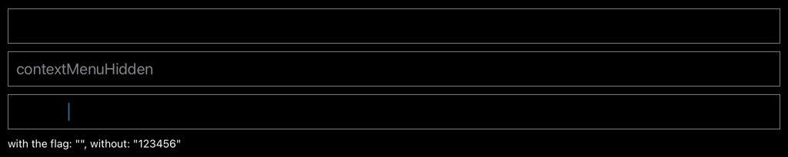
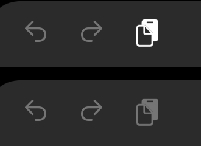
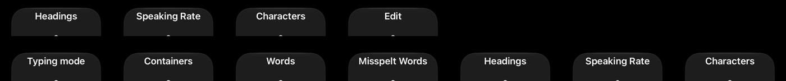

# `contextMenuHidden` and paste from a keyboard or VoiceOver

The reproducer is [`RNTesterPlayground.js`](RNTesterPlayground.js): a field holding `123456`, a field with `contextMenuHidden`, a field without it, and a line that shows what the second and the third field hold.

## Builds

RNTester from `main` at `e04aaf62f7`, with the reproducer as its Playground and the JavaScript bundle embedded.

| Platform | Build |
| --- | --- |
| iOS | Release for a device, built with Xcode 27, signed with a development profile and installed with `xcrun devicectl device install app` |
| Android | debug for x86_64 |

```sh
git switch --detach e04aaf62f7
# the reproducer in packages/rn-tester/js/examples/Playground/RNTesterPlayground.js

# iOS
yarn install --frozen-lockfile
(cd packages/react-native-codegen && yarn build)
cd packages/rn-tester
pod update hermes-engine --no-repo-update
xcodebuild -workspace RNTesterPods.xcworkspace -scheme RNTester -configuration Release -sdk iphoneos \
  -destination generic/platform=iOS CODE_SIGNING_ALLOWED=NO build

# Android, with debuggableVariants = listOf() in packages/rn-tester/android/app/build.gradle.kts so the debug build embeds its bundle
./gradlew :packages:rn-tester:android:app:assembleDebug -PreactNativeArchitectures=x86_64 \
  -x :packages:react-native:ReactAndroid:buildCodegenCLI -Preact.internal.useHermesStable=true
```

## Steps

**iPad Pro, iPadOS 27.0.1**, through a WebDriverAgent runner. The Playground is opened from RNTester's Playground tab; Cmd+A and Cmd+C are pressed in the first field, then each other field is tapped and Cmd+V pressed in it, in both orders. The chords go through the runner's `keyboardInput`; a chord sent first after a tap did nothing in either field, so a right-arrow key goes ahead of them. WebDriverAgent reads an empty field as its placeholder, so the line under the fields is what each field holds.

With VoiceOver on, each field is touched, then double-tapped to edit it, and the rotor is turned with the runner's rotate gesture, one call per turn, while the screen is recorded; the label the rotor shows after each turn is read off the recording. In the field without the prop, a flick down and a double-tap on the Edit item run its first action.

**Android 16 emulator** (stock, API 36, 1140 × 2400). [`tools/keyboard-paste.sh`](../tools/keyboard-paste.sh) copies the first field with Ctrl+A and Ctrl+C, then pastes with Ctrl+V into each other field:

```sh
tools/keyboard-paste.sh <serial> 570 343 570 520 570 697
```

## Readings

| Paste from a keyboard | iPad: Cmd+V | Android: Ctrl+V |
| --- | --- | --- |
| the field with `contextMenuHidden` | nothing is pasted | `123456` is pasted |
| the field without it | `123456` is pasted | `123456` is pasted |

On the iPad, while each field is edited:

- **VoiceOver's rotor.** In the field with `contextMenuHidden`, 16 turns cycle Typing mode, Containers, Words, Misspelt Words, Headings, Speaking Rate and Characters twice, with no Edit. In the field without it, Edit comes up every fourth turn, and its first action pastes `123456`.
- **The keyboard's Paste key** is greyed out in the field with `contextMenuHidden` and enabled in the field without it.

The tool output is in [`readings/`](readings).



After Cmd+V in the field with `contextMenuHidden`, then in the field without it. RNTester's dark theme draws the fields' text in black; the line under them shows what they hold.



The keyboard's shortcut bar while the field without the prop (top) and the field with it (bottom) is edited.



The rotor's label after each turn: the field without the prop (top), the field with it (bottom).
