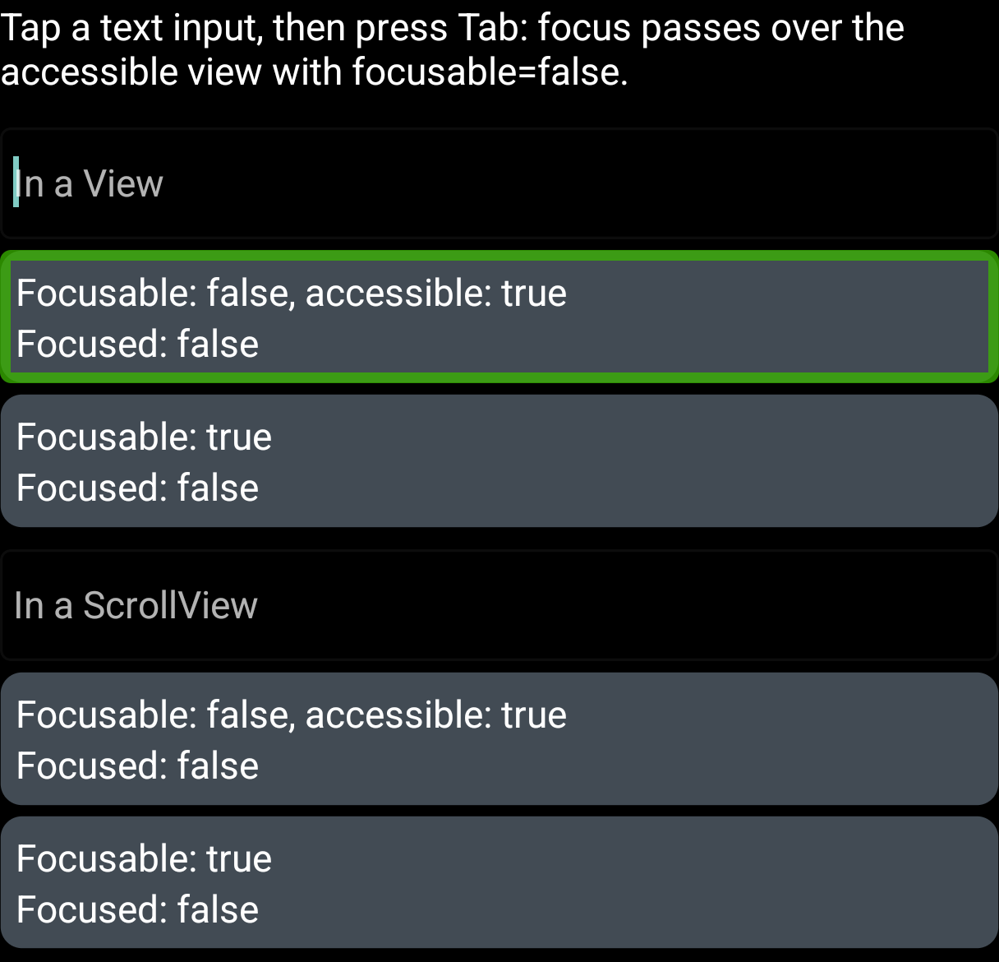

# #59048: Tab, Shift+Tab and the D-pad past `focusable={false}` on Android

[react/react-native#59048](https://github.com/react/react-native/pull/59048)

## Builds

RNTester release builds for arm64-v8a, each with [`FocusableAudit.js`](FocusableAudit.js) as its root component and an application id of its own, so they install side by side. The screen shows ten scenes, picked by a row of buttons that take no keyboard focus, and a line naming the build, the scene and the view that has focus:

| Scene | What it holds |
| --- | --- |
| `tab-index` | `First`; `Middle`, a pressable with `tabIndex={-1}`; `Last` |
| `announced` | `First`; `Announced`, an accessible `View` with `focusable={false}` and a label; `Last` |
| `removal` | the buttons `set-true`, `set-false` and `set-unset`; `First`; `Target`, an accessible `View` whose `focusable` those buttons change; `Last` |
| `ref-focus` | `FocusIt`, whose press calls `Excluded`'s `ref.focus()`, which sends a focus command only with `enableImperativeFocus` on; `Excluded`, a `tabIndex={-1}` pressable; `Last` |
| `scroll` | a vertical `ScrollView` holding `First` and, in a plain `View`, `Middle`, a `tabIndex={-1}` pressable; `Last` |
| `horizontal` | a horizontal `ScrollView` holding `First` and `Middle`, a `tabIndex={-1}` pressable, each in a column; `Last` |
| `clipped` | a `ScrollView` with `removeClippedSubviews` holding `Row1` to `Row8`, rows 3–5 with `tabIndex={-1}`; `Last` |
| `next-focus` | `First`, which names `Excluded` as its `nextFocusDown` and `nextFocusForward`; `Excluded`, a `tabIndex={-1}` pressable; `Last` |
| `touchables` | `First`; a disabled `TouchableOpacity`; a `TouchableOpacity` without `onPress`, which renders `focusable={false}`; a `TouchableHighlight`; a disabled `Pressable`; `Last` |
| `container` | `First`; `Container`, an accessible `View` with `focusable={false}` holding the pressables `Inner1` and `Inner2`; `Last` |

| Build | Source | Name in the readings |
| --- | --- | --- |
| before | `main` at `6125a5d378` | `before` |
| after | this PR: `ec5bb84c8b` on the RedMagic and the Mi MIX 3, `d73328b5b6` on the S23 | `after` |
| after, with `enablePropsUpdateReconciliationAndroid` | the after build's source with that flag on | `after-props2` |
| before, with `enableImperativeFocus` | `main` with that flag on | `before-imperative` |
| after, with `enableImperativeFocus` | the after build's source with that flag on | `after-imperative` |

`d73328b5b6`'s app differs from `ec5bb84c8b`'s only in how a view finds the `accessibilityOrder` it is in ([diff](https://github.com/react/react-native/compare/d73328b5b6..ec5bb84c8b)), and neither the scenes nor the keyboard focus exclusion example uses `accessibilityOrder`.

```sh
git switch --detach 6125a5d378   # before and before-imperative
git fetch origin ec5bb84c8b0235455d56277a08a6869579614892 && git switch --detach FETCH_HEAD   # after, after-props2 and after-imperative
git fetch origin d73328b5b6775773fe924efd51d609f055f59ec6 && git switch --detach FETCH_HEAD   # the same three on the S23
# packages/rn-tester/js/FocusableAudit.js from this folder, its VARIANT set to the build's name in the readings, and in
# packages/rn-tester/js/RNTesterApp.android.js:
#   AppRegistry.registerComponent('RNTesterApp', () => require('./FocusableAudit').default);
# the build's own suffix after com.facebook.react.uiapp in applicationId in
# packages/rn-tester/android/app/build.gradle.kts and in the blobs authority in
# packages/rn-tester/android/app/src/main/res/values/strings.xml
# a build with a flag on, at the end of RNTesterApplication.onCreate:
#   ReactNativeFeatureFlags.dangerouslyForceOverride(
#     object : ReactNativeNewArchitectureFeatureFlagsDefaults() {
#       override fun enablePropsUpdateReconciliationAndroid(): Boolean = true   // or enableImperativeFocus()
#     })
./gradlew :packages:rn-tester:android:app:assembleRelease -PreactNativeArchitectures=arm64-v8a -PenableWarningsAsErrors=true
```

## Steps

Each build is installed and opened, and each scene is picked with a tap on its button. Then the scene's keys are pressed one at a time — `adb shell input keyevent KEYCODE_TAB`, `KEYCODE_DPAD_DOWN`, `KEYCODE_DPAD_UP`, `KEYCODE_DPAD_RIGHT` or `KEYCODE_ENTER`, and Shift+Tab as `adb shell input keycombination KEYCODE_SHIFT_LEFT KEYCODE_TAB` — and after each press `adb shell uiautomator dump` names the view it marks `focused="true"` by its `accessibilityLabel`. The Mi MIX 3's Android 10 has no `keycombination`, so there Shift+Tab goes through a HID keyboard, registered before the first build is installed and kept for the whole walk, since a keyboard attached between presses restarts RNTester's activity. [`keys/mi-mix-3-hid-keyboard.jsonl`](keys/mi-mix-3-hid-keyboard.jsonl) holds the keyboard's lines: the first registers it, and the others press and release Shift and Tab. `adb shell 'rm -f /data/local/tmp/keyboard.jsonl && touch /data/local/tmp/keyboard.jsonl'` starts a file on the phone empty, and `adb shell 'tail -n +1 -f /data/local/tmp/keyboard.jsonl | hid -'` runs for the whole walk and feeds `hid` from it. The first line is appended to that file once, as `sed -n 1p keys/mi-mix-3-hid-keyboard.jsonl | adb shell 'cat >> /data/local/tmp/keyboard.jsonl'` does, and the others at each Shift+Tab, as the same command with `sed -n '2,$p'` does.

## Readings

Mi MIX 3 (Android 10), Galaxy S23 (Android 14) and RedMagic NX809J (Android 16): the three phones read the same at every step, and the build with `enablePropsUpdateReconciliationAndroid` reads as the after build at every step.

| Scene | before | after |
| --- | --- | --- |
| `tab-index` | Tab, Shift+Tab and D-pad Up land on `Middle` | pass over it |
| `announced` | Tab, Shift+Tab and D-pad Up land on `Announced` | pass over it |
| `removal` | Tab lands on `Target` whatever `focusable` is | passes over `Target` after `set-false`, lands on it again after `set-unset` and after `set-true` |
| `ref-focus` | Enter on `FocusIt` leaves focus there; the next Tab lands on `Excluded` | Enter leaves focus on `FocusIt`; the next Tab passes over `Excluded` to `Last` |
| `scroll` | Tab and Shift+Tab land on `Middle` | pass over it |
| `horizontal` | Tab and Shift+Tab land on `Middle` | pass over it |
| `clipped` | Tab and Shift+Tab land on rows 3, 4 and 5 | pass from row 2 to row 6 and back |
| `next-focus` | D-pad Down and Tab from `First` land on `Excluded`, which `First` names | move on to `Last` |
| `touchables` | Tab and Shift+Tab land on the `TouchableOpacity` without `onPress` | pass over it |
| `container` | Tab lands on `Container`, then on its two pressables, and Shift+Tab on the two pressables, then on `Container` | Tab and Shift+Tab land on its two pressables only |

Each build passes over the disabled `TouchableOpacity` and `Pressable`, and apart from the views this table names, each moves through the same views in the same order. D-pad Down in `tab-index` and `announced`, and D-pad Right in `horizontal`, start from `Last`, which has nothing below or beside it, so they read the same in every build.

With `enableImperativeFocus` on, the three phones read as with the flag off in every scene but `ref-focus`, where Enter on `FocusIt` calls `Excluded`'s `ref.focus()`:

| `ref-focus`, `enableImperativeFocus` on | before | after |
| --- | --- | --- |
| Enter on `FocusIt` | focuses `Excluded` | focuses `Excluded` |
| then Tab, then Shift+Tab | `Last`, then back to `Excluded` | `Last`, then past `Excluded` to `FocusIt` |

Each step, per phone: [`readings/mi-mix-3-keys.txt`](readings/mi-mix-3-keys.txt), [`readings/galaxy-s23-keys.txt`](readings/galaxy-s23-keys.txt) and [`readings/redmagic-nx809j-keys.txt`](readings/redmagic-nx809j-keys.txt), a line per build, each entry the key and the view that has focus after it. `[none]` is the screen before the first key, and `tap touch-set-false:none` is a tap on the `set-false` button, after which no view has focus.

## TalkBack

RNTester release builds for arm64-v8a with the keyboard focus exclusion example: before is `main` at `6125a5d378` with this PR's `FocusEventsExample.android.js`, after is this PR at `ec5bb84c8b`. The example opens with `adb shell am start -a android.intent.action.VIEW -d rntester://example/FocusEventsExample/keyboard-focus-exclusion <the build's application id>`, and its view tree is read, and a screenshot taken, while TalkBack is off. Then TalkBack is turned on with `adb shell settings put secure enabled_accessibility_services <TalkBack's service>` and `adb shell settings put secure accessibility_enabled 1`, the service being `com.google.android.marvin.talkback/.TalkBackService` on the RedMagic and the Mi MIX 3 and `com.samsung.android.accessibility.talkback/com.samsung.android.marvin.talkback.TalkBackService` on the S23. TalkBack's touch exploration ignores `adb shell input`, so each gesture is a file of [`talkback/`](talkback) that registers a touchscreen and plays its touches, with `adb shell uinput - < <file>`, or on the Mi MIX 3, whose Android 10 has no `uinput` command, with `adb shell hid - < <file>`: on each phone a held touch on the first text input, then on both texts of the view's accessible `focusable={false}` row, of its `focusable` row and of the scroll view's accessible `focusable={false}` row, each file named by the phone and the point it touches; on the S23 and the Mi MIX 3 also a held touch on the first text input, then eight swipes right. On the RedMagic, TalkBack took none of the swipes a `uinput` touchscreen gave, and its `hid` command registered no touchscreen, so its readings are touches alone. After each gesture a screenshot is taken, and TalkBack's focus is the box around the pixels of its focus rectangle, green in Google's TalkBack and blue in Samsung's, that the screenshot with TalkBack off does not have. The readings name the node of the view tree whose bounds overlap that box most, as intersection over union.

| With TalkBack on | before | after |
| --- | --- | --- |
| RedMagic NX809J (Android 16), TalkBack 17.1: touch either text of the accessible `focusable={false}` row, in the view and in the scroll view | the whole row on 8 of 8 touches | the whole row on 8 of 8 touches |
| Mi MIX 3 (Android 10), TalkBack 17.1: the same touches | the whole row on 8 of 8 touches | the whole row on 8 of 8 touches |
| Galaxy S23 (Android 14), Samsung TalkBack 14.1: the same touches | the whole row on 8 of 8 touches | the whole row on 8 of 8 touches |
| Each phone: touch either text of the view's `focusable` row | the whole row on 4 of 4 touches | the whole row on 4 of 4 touches |
| Mi MIX 3, TalkBack 17.1, and Galaxy S23, Samsung TalkBack 14.1: swipe right eight times from the first text input | the accessible `focusable={false}` row, whole; then the `focusable` row; then that row's two texts one by one; then the scroll view's text input, its accessible `focusable={false}` row, whole, its `focusable` row and that row's first text | the same |

Each phone's touches come from two runs, each touching both texts of each row once, and the swipes on the Mi MIX 3 and the S23 from two runs each. The `focusable` row is there for contrast: a touch focuses it whole too, but the swipes then visit its two texts one by one, which they never do for an accessible `focusable={false}` row. An earlier run on the S23 at `d73328b5b6`, one run per build and five swipes long ([readings](readings/galaxy-s23-talkback-swipes-d73328b5b6.txt)), left TalkBack's focus on the text input at the after build's first swipe, and its later swipes reached the same stops one swipe behind; neither run at `ec5bb84c8b` repeats that. Each gesture: [`readings/redmagic-nx809j-talkback-touches.txt`](readings/redmagic-nx809j-talkback-touches.txt), [`readings/mi-mix-3-talkback-touches.txt`](readings/mi-mix-3-talkback-touches.txt), [`readings/galaxy-s23-talkback-touches.txt`](readings/galaxy-s23-talkback-touches.txt) and, for the swipes, [`readings/mi-mix-3-talkback-swipes.txt`](readings/mi-mix-3-talkback-swipes.txt) and [`readings/galaxy-s23-talkback-swipes.txt`](readings/galaxy-s23-talkback-swipes.txt).

| before | after |
| --- | --- |
|  |  |

The RedMagic after a touch on the first text of the accessible `focusable={false}` row in the view, cropped to the example; the two builds' screenshots are the same pixel for pixel.

## C++ tests

Copy [`cxx-tests/`](cxx-tests) to the repository root. Its `project-include.cmake` adds three targets to ReactAndroid's arm64-v8a Debug CMake tree: the NDK's googletest as a static library; `android_gtests`, a shared library of `ViewTest.cpp`, `ViewPropsDiffTest.cpp` and `cxx-tests/main.cpp` linked against `libreactnative.so` and that googletest; and `android_gtests_launcher`, which loads it and runs its tests. From the repository root:

```sh
./gradlew ':packages:react-native:ReactAndroid:buildCMakeDebug[arm64-v8a]' -PreactNativeArchitectures=arm64-v8a
tree=$(ls -dt packages/react-native/ReactAndroid/.cxx/Debug/*/arm64-v8a | head -1)
tests=$PWD/packages/react-native/ReactCommon/react/renderer/components/view/tests
"$(sed -nE 's/^CMAKE_COMMAND:[A-Z]+=//p' "$tree/CMakeCache.txt")" "$tree" \
  -DCMAKE_PROJECT_ReactAndroid_INCLUDE="$PWD/cxx-tests/project-include.cmake" \
  "-DANDROID_GTEST_SOURCES=$tests/ViewTest.cpp;$tests/ViewPropsDiffTest.cpp"
"$(sed -nE 's/^CMAKE_MAKE_PROGRAM:[A-Z]+=//p' "$tree/CMakeCache.txt")" -C "$tree" android_gtests android_gtests_launcher
```

Then, with an arm64 phone on `adb`, the launcher, the library and the libraries they load go to one folder on it, where the tests run:

```sh
objects=packages/react-native/ReactAndroid/build/intermediates/cxx/Debug/$(basename "$(dirname "$tree")")/obj/arm64-v8a
fbjni=$(grep -o -m 1 '[^ ]*/libfbjni\.so' "$tree/build.ninja")
ndk=$(sed -nE 's/^ANDROID_NDK:[A-Z]+=//p' "$tree/CMakeCache.txt")
adb shell mkdir -p /data/local/tmp/view-gtests
adb push "$objects/android_gtests_launcher" "$objects/libandroid_gtests.so" "$objects/libreactnative.so" "$objects/libjsi.so" \
  "$fbjni" "$ndk"/toolchains/llvm/prebuilt/*/sysroot/usr/lib/aarch64-linux-android/libc++_shared.so /data/local/tmp/view-gtests
adb shell "cd /data/local/tmp/view-gtests && chmod 755 android_gtests_launcher && LD_LIBRARY_PATH=. ./android_gtests_launcher '--gtest_filter=ViewTest.*:ImperativeFocusViewTest.*:ViewPropsDiffTest.*'"
```

On the Android 15 x86_64 emulator, the same arm64 files run under the emulator's arm64 translation, which reads the library path only from `BERBERIS_GUEST_LD_LIBRARY_PATH`:

```sh
adb shell "cd /data/local/tmp/view-gtests && chmod 755 android_gtests_launcher && BERBERIS_GUEST_LD_LIBRARY_PATH=. ./android_gtests_launcher '--gtest_filter=ViewTest.*:ImperativeFocusViewTest.*:ViewPropsDiffTest.*'"
```
The 19 cases pass with this PR on the Galaxy S23 and on an Android 15 x86_64 emulator. On `main` with this PR's two test files, the 13 existing cases pass and 4 of the 6 new ones fail.
