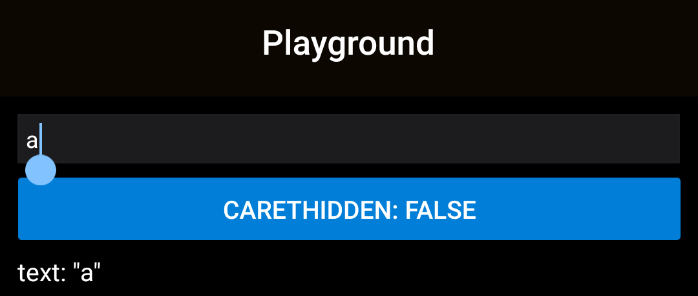
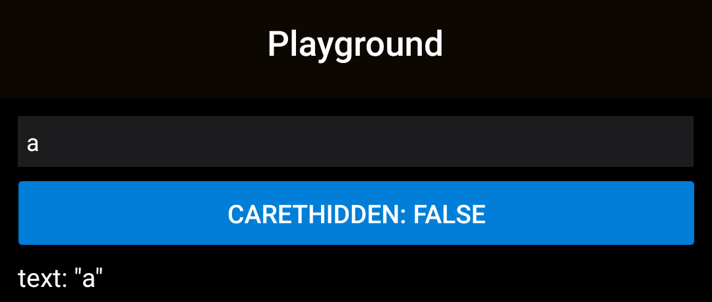

# #59124: an email field's cursor when `caretHidden` changes, on a Xiaomi phone with Android 10

[react/react-native#59124](https://github.com/react/react-native/pull/59124)

## Builds

RNTester release builds for arm64-v8a, both running the Playground from the PR description: an `email-address` field, a button that turns `caretHidden` on and off, and the field's text.

| Build | Source |
| --- | --- |
| before | `main` at `68b7ce2abe`, the PR's base, with the PR's Playground |
| after | the PR head, `7a2cf6316f`, with the same Playground |

```sh
git fetch origin pull/59124/head
git switch --detach 68b7ce2abe   # before
git switch --detach 7a2cf6316f   # after
# each: the Playground from the PR description in packages/rn-tester/js/examples/Playground/RNTesterPlayground.js, then
./gradlew :packages:rn-tester:android:app:assembleRelease -PreactNativeArchitectures=arm64-v8a -Preact.internal.useHermesStable=true
```

R8 renames the members the PR adds, so the builds are told apart by `ReactTextInputManager`'s calls to `setCursorVisible` (`dexdump -d`): two in the before build, from `setCaretHidden` and `setKeyboardType`, and one in the after build. SHA-256 of the APKs: before `398847918f495e26…`, after `b1f6027be32405be…`.

## Steps

1. `adb shell am start -a android.intent.action.VIEW -d rntester://example/PlaygroundExample`
2. Tap the field. `adb shell cmd autofill destroy sessions` ends the autofill session the tap starts, so no autofill picker covers the field.
3. `adb shell input text a`
4. Press the button: `caretHidden` turns `true`.
5. Press it again: `caretHidden` turns `false`.
6. `adb shell input text @`

After steps 2 to 5, [`tools/count-distinct-frames.sh`](../tools/count-distinct-frames.sh) takes 10 screenshots and counts the different images of the field, at x 27–1052 and y 277–354 on the Mi MIX 3: a blinking cursor shows 2, a field with no cursor 1.

## Readings

Mi MIX 3: Android 10 (API 29), MIUI 12, 1080 × 2340. Different images of the field in 10 screenshots:

| After | before | after |
| --- | --- | --- |
| the tap | 1 | 1 |
| typing `a` | 1 | 1 |
| `caretHidden` turns `true` | 1 | 1 |
| `caretHidden` turns `false` again | 2: the cursor blinks | 1 |

Typing `@` afterwards crashed neither build: the same app process before and after, and no fatal log line. Two rounds per build, the rounds alike; the tool output is in [`readings/`](readings).

| before | after |
| --- | --- |
|  |  |

After step 5.
