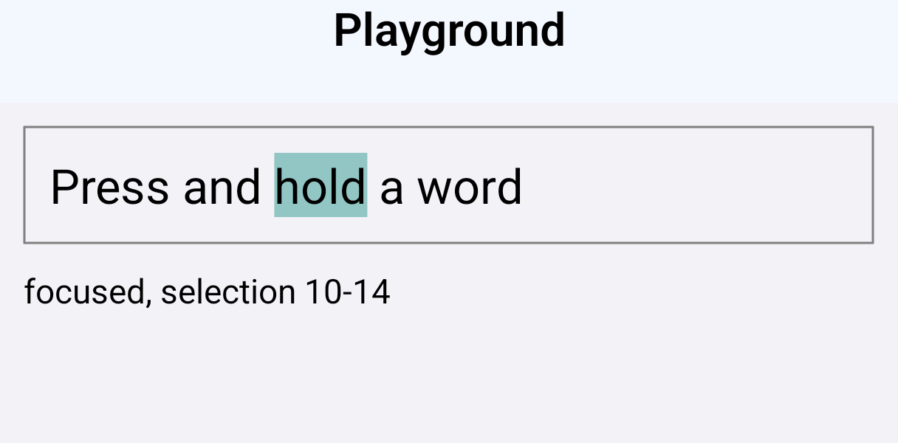
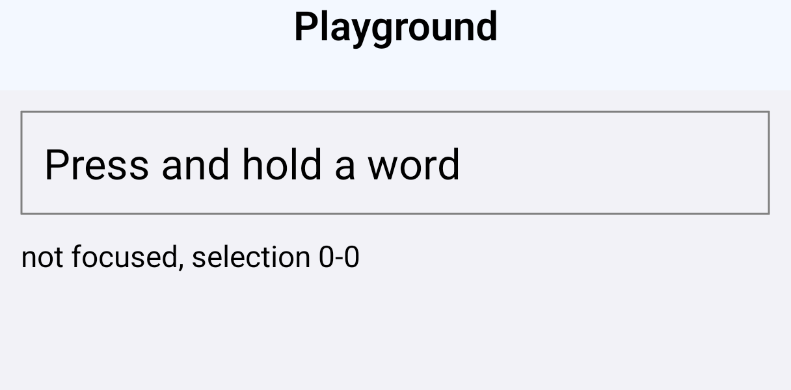

# #59130: a long press on a `TextInput` with `contextMenuHidden`

[react/react-native#59130](https://github.com/react/react-native/pull/59130)

## Builds

RNTester debug builds for arm64-v8a with the JavaScript bundle embedded, both running the Playground from the PR description: a field with `contextMenuHidden` holding "Press and hold a word", and a line reporting whether it is focused and its selection.

| Build | Source |
| --- | --- |
| before | the PR head `02736ea1e5` with `ReactEditText.kt` from `main` at `68b7ce2abe`, the PR's base: the one file the PR changes that ships in the app |
| after | the PR head, `02736ea1e5` |

```sh
git fetch origin pull/59130/head
git switch --detach 02736ea1e5
# the Playground from the PR description in packages/rn-tester/js/examples/Playground/RNTesterPlayground.js,
# and debuggableVariants = listOf() in packages/rn-tester/android/app/build.gradle.kts so the debug build embeds its bundle

# before only
K=packages/react-native/ReactAndroid/src/main/java/com/facebook/react/views/textinput/ReactEditText.kt
git show 68b7ce2abe:$K > $K

# each
./gradlew :packages:rn-tester:android:app:assembleDebug -PreactNativeArchitectures=arm64-v8a \
  -x :packages:react-native:ReactAndroid:buildCodegenCLI -Preact.internal.useHermesStable=true
```

Only the after build's `ReactEditText` declares `setLongClickable` (`dexdump`). SHA-256 of the APKs: before `a5ec58dc6a09f3f5…`, after `8d2ab855a3aab939…`.

## Steps

`adb shell am start -a android.intent.action.VIEW -d rntester://example/PlaygroundExample` opens the Playground with the field not focused; the app is stopped and opened again before each case. [`tools/hold-press.sh`](../tools/hold-press.sh) holds a finger on the word "hold" with `input motionevent DOWN`, reads the screen 1.5 s later, then lifts:

1. Lift on the field: `tools/hold-press.sh <serial> <x> <y>`
2. Slide off the field and lift: `tools/hold-press.sh <serial> <x> <y> 1.5 <x> 1500`

| Phone | "hold" at |
| --- | --- |
| RedMagic NX809J | 380, 400 |
| Galaxy S23 | 350, 352 |
| Mi MIX 3 | 321, 344 |

## Readings

What the Playground's line reports, and the keyboard after the lift:

| | RedMagic NX809J, Android 16 (API 36) | Galaxy S23, Android 14 (API 34) | Mi MIX 3, Android 10 (API 29) |
| --- | --- | --- | --- |
| held, before | focused, selection 10-14 | focused, selection 10-14 | focused, selection 10-14 |
| held, after | not focused, selection 0-0 | not focused, selection 0-0 | not focused, selection 0-0 |
| lifted on the field, before | focused, 14-14, keyboard down | focused, 14-14, keyboard down | focused, 10-14, keyboard down |
| lifted on the field, after | focused, 10-10, keyboard up | focused, 10-10, keyboard up | focused, 10-10, keyboard up |
| slid off and lifted, before | focused, 14-14 | focused, 14-14 | focused, 10-14 |
| slid off and lifted, after | not focused, 0-0 | not focused, 0-0 | not focused, 0-0 |

The field reads `long-clickable="true"` with the before build and `long-clickable="false"` with the after build on every phone. One round per case on the RedMagic and the S23 and two on the Mi MIX 3, the rounds alike; the tool output is in [`readings/`](readings).

| before | after |
| --- | --- |
|  |  |

The RedMagic while the finger is held on "hold", light theme.
