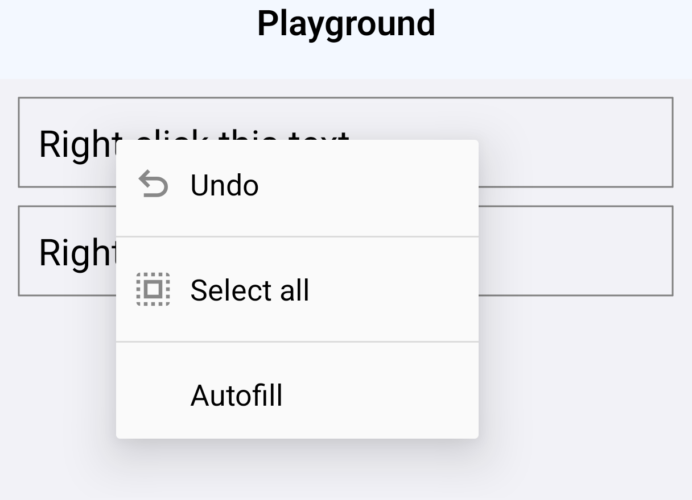
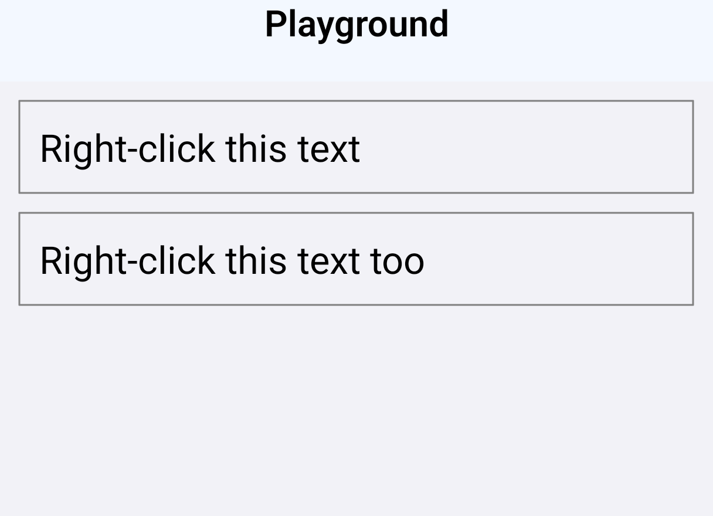

# #59136: a right-click on a `TextInput` with `contextMenuHidden`

[react/react-native#59136](https://github.com/react/react-native/pull/59136)

## Builds

RNTester debug builds for arm64-v8a with the JavaScript bundle embedded, both running the Playground from the PR description: a field with `contextMenuHidden` and a field without it.

| Build | Source |
| --- | --- |
| before | the PR head `7da4289622` with `ReactEditText.kt` from `main` at `e04aaf62f7`, the PR's base: the one file the PR changes that ships in the app |
| after | the PR head, `7da4289622` |

```sh
git fetch origin pull/59136/head
git switch --detach 7da4289622
# the Playground from the PR description in packages/rn-tester/js/examples/Playground/RNTesterPlayground.js,
# and debuggableVariants = listOf() in packages/rn-tester/android/app/build.gradle.kts so the debug build embeds its bundle

# before only
K=packages/react-native/ReactAndroid/src/main/java/com/facebook/react/views/textinput/ReactEditText.kt
git show e04aaf62f7:$K > $K

# each
./gradlew :packages:rn-tester:android:app:assembleDebug -PreactNativeArchitectures=arm64-v8a \
  -x :packages:react-native:ReactAndroid:buildCodegenCLI -Preact.internal.useHermesStable=true
```

Only the after build's `ReactEditText` declares `onCreateContextMenu` (`dexdump`). SHA-256 of the APKs: before `9fbc2bbc5c6d5db0…`, after `7c504e5e71ae6ff3…`.

## Steps

`adb shell am start -a android.intent.action.VIEW -d rntester://example/PlaygroundExample` opens the Playground; the app is stopped and opened again before each case. A virtual mouse drives every case: [`tools/mouse-click.mjs`](../tools/mouse-click.mjs) registers it through the `uinput` shell command and clicks a point, and [`tools/right-click-caret.sh`](../tools/right-click-caret.sh) puts a field's caret at the end of its text with a left click, right-clicks the start of the text, closes any menu and types `Z`.

1. Right-click the first field while it is not focused: `node tools/mouse-click.mjs <serial> 200 400 right`
2. The first field, focused: `tools/right-click-caret.sh <serial> 1100 75 400`
3. The second field, focused: `tools/right-click-caret.sh <serial> 1100 75 591`

The coordinates are the RedMagic's, where the fields span x 32–1183 at y 321–480 and 512–671. An open menu is the popup windows `dumpsys window` lists.

## Readings

RedMagic NX809J: Android 16 (API 36), 1216 × 2688, light theme.

| Right-click | before | after |
| --- | --- | --- |
| the field with `contextMenuHidden`, not focused | the menu opens: 3 popup windows | nothing opens |
| the field with `contextMenuHidden`, focused with its caret at the end, clicked at the start | the menu opens: 3 popup windows; `Z` lands at the click: `ZRight-click this text` | nothing opens; `Z` lands at the end: `Right-click this textZ` |
| the field without the flag, the same | the menu opens: 3 popup windows; `ZRight-click this text too` | the menu opens: 3 popup windows; `ZRight-click this text too` |

The tool output is in [`readings/`](readings).

| before | after |
| --- | --- |
|  |  |

Step 1, a second after the right-click.
